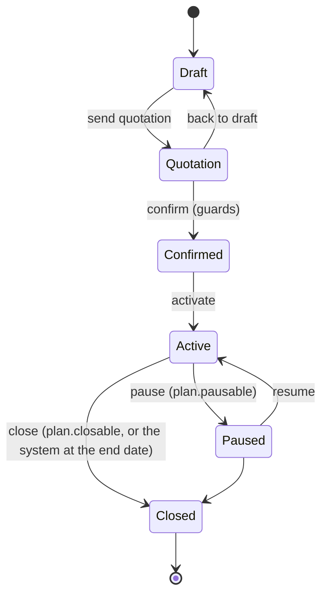
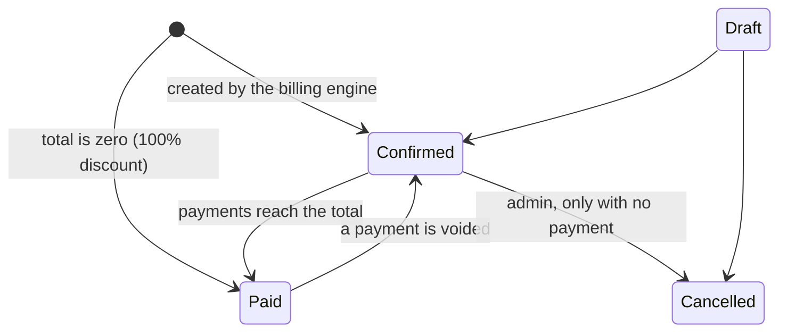

# Architecture and trade-offs

## Stack and why

| Choice | Why |
|---|---|
| Django 5.1 + PostgreSQL | Auth, ORM, migrations, password validators, CSRF and the admin come built in, so time went into the billing logic instead of plumbing. PostgreSQL gives row locks, partial indexes and CHECK constraints that the design relies on. |
| Server-rendered HTML + HTMX + Alpine + Tailwind | One codebase and one deploy, instant search, inline edits and partial refreshes without a JavaScript build step. Every page also works without JavaScript (forms fall back to normal posts). |
| Modular monolith | One deployable with clear internal boundaries. Microservices would add network failure modes and distributed transactions to a problem where one database transaction is exactly what is wanted (an invoice, its numbers and a discount redemption commit together). |
| Money as `Decimal`, one rounding rule | Half-up to 2 places, in `apps/core/money.py`. Floats are never used for money. |

## Modules and dependency direction

```
core            audit log, number sequences, money, permissions, scoping, pagination
accounts        users, roles, sign-up, login, password reset, staff, customer directory
taxes           tax rules and the calculator (pure functions)
catalog         products, variants, plans
discounts       rules, eligibility engine (pure), usage counter
subscriptions   templates, subscriptions, lines, state machine, history, pricing (pure)
billing         periods (pure), invoices, the billing engine
payments        payments, void, outstanding / overdue figures
reports         dashboard figures, filters, CSV exports
portal          customer-facing read-only pages
demo            seed data, integrity checks, performance check (development tools)
```

Dependencies only point downwards: `portal` and `reports` read from `payments`, `billing`, `subscriptions`;
`billing` uses `subscriptions`, `discounts`, `taxes`; nothing imports from `portal`, `reports` or `demo`.
`core` imports nothing from the feature apps (the home page hands over to the dashboards lazily, in one place).

Each feature app follows the same layout, so any file is easy to find:

| File | Responsibility |
|---|---|
| `models.py` | Tables, constraints and indexes. No business rules beyond data shape. |
| `services.py` | Every write. Re-checks the actor's role, runs in a transaction, writes the audit log. |
| `selectors.py` | Every read query (including customer scoping), so views never build querysets. |
| `forms.py`, `views.py`, `urls.py` | Thin: parse input, call a service or selector, render. |
| `tests/` | Unit tests for rules, view tests for access and rendering, concurrency tests where it matters. |

## State machines

Subscription (`apps/subscriptions/workflow.py`, one table of allowed moves):



Confirm checks, and reports together, that there is at least one line, every line meets the plan minimum quantity,
the plan is active and covers the start date, the quotation has not expired, and the customer is active. Every move
locks the row, writes a history row and an audit entry.

Invoice (`apps/billing/services.py`, `apps/payments/services.py`):



## The billing engine (`apps/billing/engine.py`)

1. Find active subscriptions whose `next_billing_date` is today or earlier (served by a partial index).
2. For each one, in its own transaction: lock the row (`FOR UPDATE SKIP LOCKED`), price the lines
   (discount first, tax after), create the invoice and lines with copied values, redeem the discount, move
   `next_billing_date` forward one period.
3. After the last period, close the subscription (plans with auto-close) or stop billing (others).
4. A failure rolls back only that subscription and is reported; the run continues.

Why it cannot bill twice: the row lock stops two workers taking the same subscription; the engine checks for an
existing invoice for the period and only moves the date on; and `UNIQUE (subscription_id, period_start)` makes a
duplicate impossible even if both of those failed. A subscription that is several periods behind is caught up one
invoice per period. Monthly and yearly dates stay on the start day (31 Jan, 28 Feb, 31 Mar).

Pricing order (`apps/subscriptions/pricing.py`, shared by previews and invoices so they always agree): line amount,
then the single best eligible discount shared across the lines it covers (the shares add up to the cent), then tax
on each discounted line.

## Security

| Concern | How it is handled |
|---|---|
| Passwords | More than 8 characters with upper, lower and special character (backend validator, plus the same rule on the forms); Argon2 hashing; common-password check. |
| Reset | Single-use, one-hour link; the response never reveals whether an email exists; email goes to the console or SMTP, no external API. |
| Brute force | Rate limits on login, sign-up and password reset. |
| Roles | Decorators on every view and a re-check inside every service. Admin, staff and customer are tested against every page and every POST action. |
| Customer data | One scoping helper (`apps/core/scoping.py`) restricts customers to their own rows; drafts are hidden from them; other customers' ids give 404. |
| CSRF and sessions | Django CSRF on every form and HTMX call, httpOnly and SameSite cookies, secure cookies and HSTS in production settings. |
| Injection | ORM only (parameterised queries); templates auto-escape; CSV cells that start with `= + - @` are neutralised. |
| Audit | Staff changes, catalog and rule changes (with before and after values), status changes, payments and voids, cancellations, billing runs and exports are written to an append-only log that is read-only in the Django admin. |
| Concurrency | Row locks for status changes, payments and billing; atomic discount redemption; tests fire parallel threads at each. |

`python manage.py check --deploy` with the production settings reports only two optional HSTS settings
(`INCLUDE_SUBDOMAINS`, `PRELOAD`), which are left off on purpose because they affect every subdomain of a domain.

## Performance

Aggregates instead of Python loops, server-side pagination and filtering, `select_related` on every list, annotated
totals instead of per-row queries, partial and composite indexes for the hot lookups. Tests assert that the number
of queries per page does not grow with the number of rows. Measured numbers are in `PERFORMANCE.md`.

## Testing

Run `python manage.py test`. About 470 tests cover: rules and edge cases (rounding, period arithmetic, discount
eligibility, state machine guards), permissions on every page and action, concurrency (parallel billing runs,
parallel payments, parallel discount redemption), no-N+1 query counts, CSV safety, and an integrity checker
(`python manage.py verify_data`) that proves invoices, lines, payments, discounts and subscriptions still add up.
The checker is itself tested by corrupting data and confirming it is caught.

## Decisions and known limits

* **No proration.** A period is always billed whole. Simple to explain and audit; mid-period changes would need credit notes.
* **No stacking of discounts.** The best single discount wins. A different rule would only need `engine.best_discount` changed.
* **Cancelled invoices keep their period billed.** There is no credit-note flow, so a cancelled period is not re-billed.
* **Payments are per invoice.** There is no single payment split across several invoices, and no refunds beyond voiding a wrong entry.
* **Customers cannot act online.** The portal is read-only: no pause, close, renewal or online payment.
* **The billing run is synchronous.** It runs from a button or `run_billing` (cron). About 60 invoices per second in the
  measured setup; a background worker and batching would be the next step for very large runs.
* **Email** goes to the console in development; set `EMAIL_BACKEND` for SMTP.
