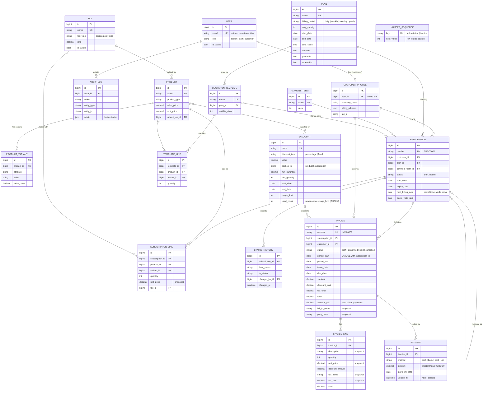

# Entity relationship diagram

Rendered automatically by GitHub and by the VS Code "Markdown Preview Mermaid Support" extension.

## Constraints worth knowing (all enforced by PostgreSQL, not just by forms)

| Rule | Where |
|---|---|
| A subscription period is never billed twice | `UNIQUE (subscription_id, period_start)` on invoices |
| Names are unique ignoring case (user email, product, plan, tax, discount, template) | `UNIQUE (lower(name))` |
| Discount usage never exceeds its limit | `CHECK used_count <= usage_limit` plus one guarded `UPDATE` |
| An invoice is never over-paid | `CHECK amount_paid <= total` |
| Payments are positive | `CHECK amount > 0` |
| Dates and quantities make sense | `CHECK end_date >= start_date`, `quantity >= 1`, percent `<= 100` |
| "Due for billing" lookups stay fast | partial index on `next_billing_date` where `status = 'active'` |
| Overdue lookups stay fast | index on `(due_date, status)` |

## Why invoices copy data instead of pointing at it

Invoice and invoice-line rows store the customer name, address, plan name, product description, unit price,
tax name and rate, and discount. Changing a price, a tax rate or a customer later never alters an invoice that was
already issued. Overdue is derived from `due_date`, `status` and the balance, so it can never go stale.
